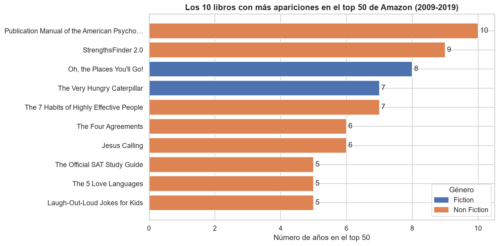
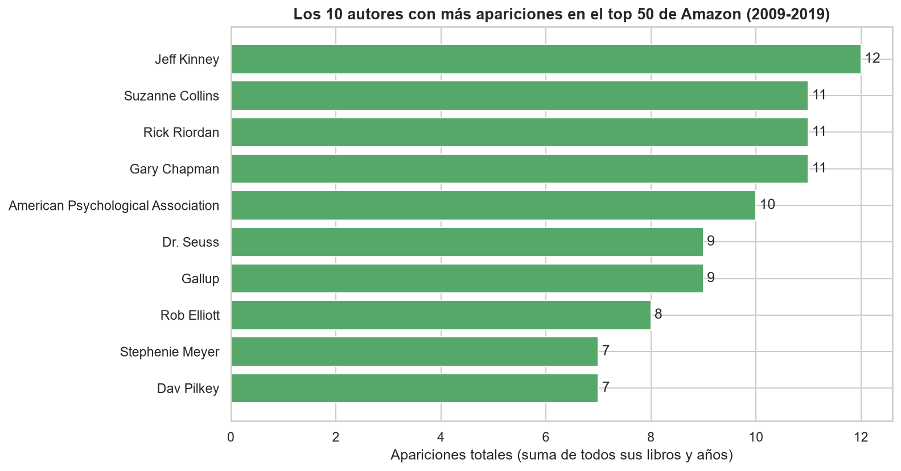
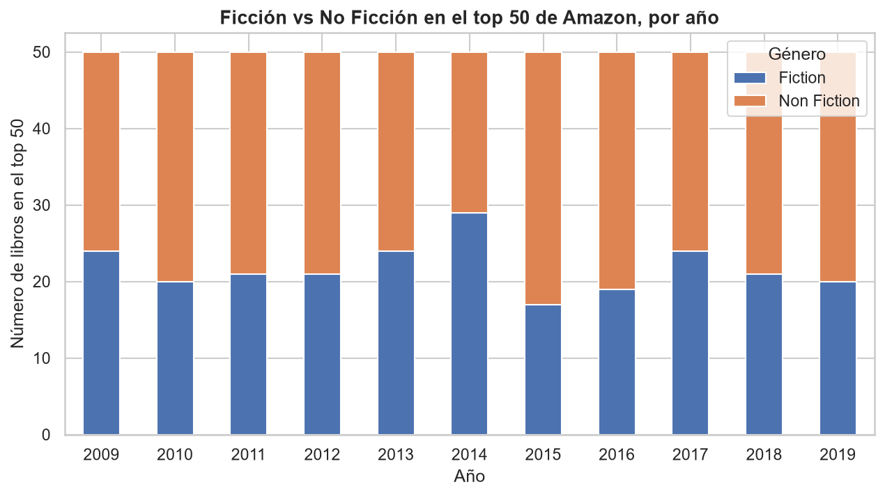
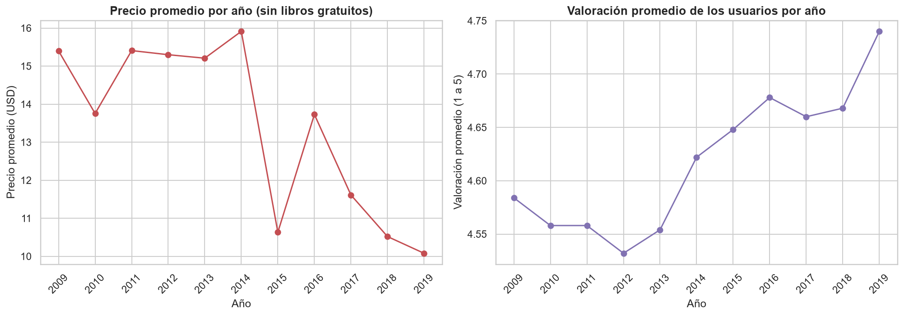
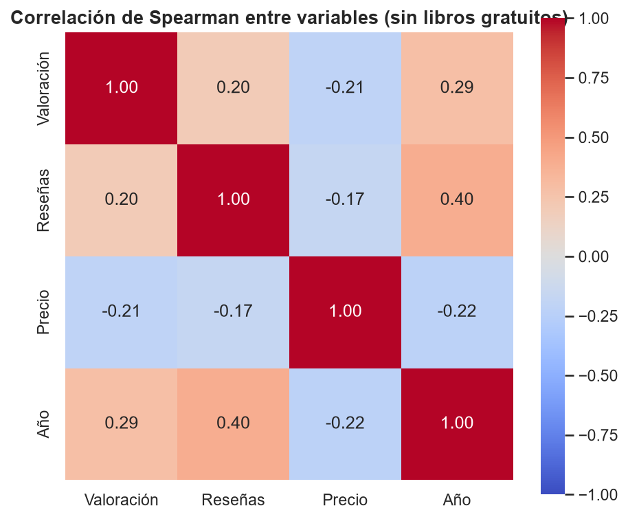

#  Análisis de los libros más vendidos de Amazon (2009-2019)


Análisis exploratorio de los 50 libros más vendidos de Amazon cada año entre 2009 y 2019, usando Python y pandas: desde la carga y limpieza de datos hasta visualizaciones y conclusiones.

##  Objetivo

Responder cuatro preguntas a partir de los datos:

1. ¿Qué libros y autores aparecen más veces en el top 50?
2. ¿Cómo se comparan ficción y no ficción?
3. ¿Cómo evolucionaron género, precio y valoración a lo largo de los años?
4. ¿Hay relación entre precio, valoración y número de reseñas?

##  Resultados principales

- **Pocos libros dominan, la mayoría pasa fugazmente:** de 351 libros únicos, 255 (72,6 %) aparecen una sola vez. Los más recurrentes son manuales de referencia, autoayuda y clásicos infantiles, como *Publication Manual of the APA* (10 apariciones), *StrengthsFinder 2.0* (9) y *Oh, the Places You'll Go!* (8).
- **No ficción tiene más presencia; ficción, más reseñas:** 310 apariciones frente a 240 de ficción, y solo en 2014 la ficción superó a la no ficción. La no ficción es más cara (mediana de 12 USD vs 9 USD, sin contar libros gratuitos), pero la ficción tiene una mediana de reseñas mayor (10.922 vs 6.346).
- **La valoración sube y el precio baja:** la valoración promedio pasó de 4,58 (2009) a 4,74 (2019), y el precio promedio bajó de unos 15 USD antes de 2015 a unos 10 USD en 2018-2019.
- **Las correlaciones son débiles o moderadas:** la más alta (0,40) es entre año y número de reseñas, pero las reseñas son una foto del momento de extracción de los datos, así que no implica que los libros sean cada vez más populares.
- **Autor con más presencia:** Jeff Kinney aparece 12 veces en el top 50 durante el periodo analizado.

### Libros más recurrentes


### Autores con más presencia


### Ficción vs No Ficción por año


### Evolución del precio y la valoración


### Correlaciones


##  Dataset

- **Fuente:** [Amazon Top 50 Bestselling Books 2009-2019](https://www.kaggle.com/datasets/sootersaalu/amazon-top-50-bestselling-books-2009-2019), de Sooter Saalu en Kaggle.
- **Tamaño:** 550 registros (50 por año) y 7 columnas.

| Columna | Descripción |
|---|---|
| `Name` | Título del libro |
| `Author` | Autor |
| `User Rating` | Valoración promedio de los usuarios (1 a 5) |
| `Reviews` | Número de reseñas |
| `Price` | Precio en USD |
| `Year` | Año del ranking |
| `Genre` | Ficción o No Ficción |

> **Nota metodológica:** el dataset no incluye unidades vendidas. "Más vendido" se interpreta como "más presente en el top 50 anual de Amazon".

##  Proceso de limpieza

- Columnas renombradas a `snake_case`.
- Normalización de espacios en los campos de texto: se modificaron 2 valores en `author` (0 en `name` y 0 en `genre`).
- 12 libros con precio 0 conservados y marcados con la columna `is_free` (excluidos solo en los análisis de precio).
- Los títulos repetidos entre años se conservaron: cada fila es una aparición anual en el ranking.
- Se encontraron 3 títulos repetidos dentro del mismo año: *The Fault in Our Stars* (2014), *The Help* (2011) y *Unbroken* (2014). Cada par tiene precios distintos y se conservaron las filas; el dataset no incluye un identificador de edición para confirmar si son ediciones diferentes.
- Validaciones automáticas de rangos y valores nulos.

##  Tecnologías

- Python
- pandas
- matplotlib y seaborn
- Jupyter Notebook (VS Code)
- Git y GitHub

##  Estructura del repositorio

```
amazon-bestsellers-analysis/
├── data/
│   ├── raw/          # CSV original, sin modificar
│   └── processed/    # Dataset limpio
├── notebooks/
│   ├── 01_exploracion_datos.ipynb
│   ├── 02_limpieza_datos.ipynb
│   ├── 03_analisis.ipynb
│   └── 04_visualizaciones.ipynb
├── images/           # Gráficos generados
├── requirements.txt
├── LICENSE
└── README.md
```

##  Cómo ejecutarlo

1. Clona el repositorio:

```bash
git clone https://github.com/XNico619X/amazon_bestsellers_analysis.git
cd amazon_bestsellers_analysis
```

2. Crea y activa un entorno virtual:

```bash
python -m venv venv
# Windows (PowerShell)
.\venv\Scripts\Activate.ps1
# Mac / Linux
source venv/bin/activate
```

3. Instala las dependencias:

```bash
pip install -r requirements.txt
```

4. Abre los notebooks de la carpeta `notebooks/` (en VS Code o con `jupyter notebook`) y ejecútalos en orden numérico.

##  Limitaciones

- No hay datos de unidades vendidas: se mide presencia en el ranking.
- Algunos títulos y autores aparecen truncados en la fuente (por ejemplo, `JOURNEY TO THE ICE P` y `Delegates of the Constitutional`).
- El número de reseñas corresponde al momento de extracción de los datos, no al de cada año.
- Las correlaciones describen asociación, no causalidad.

## 🚀 Próximos pasos

- [ ] Dashboard interactivo en Power BI
- [ ] Ampliar el dataset con años posteriores si se encuentra una fuente comparable.

## 👤 Autor

Nicolas Espinosa Bedoya
- GitHub: https://github.com/XNico619X
- LinkedIn: https://www.linkedin.com/in/nicolas-espinosa-bedoya-data-analyst/

